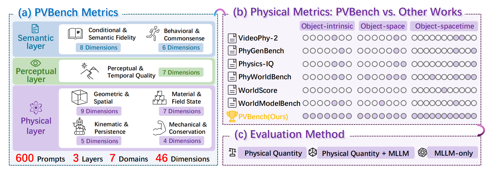
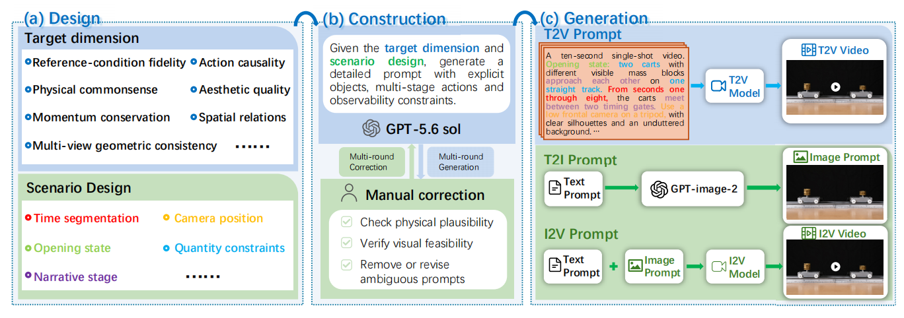
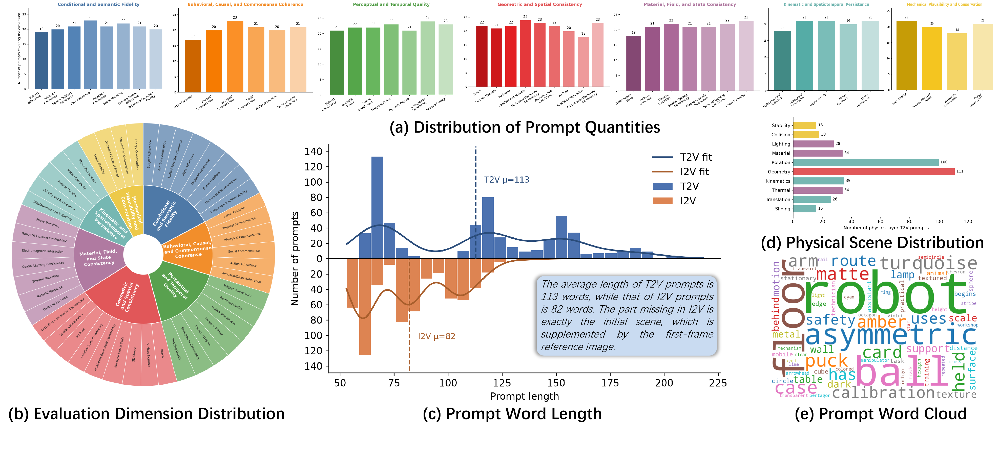
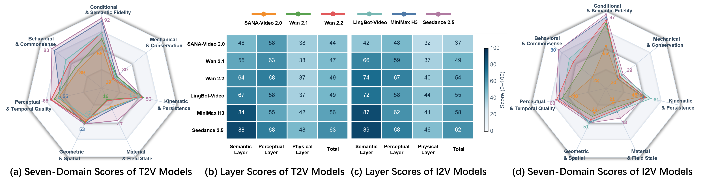

<div align="center">

<h1>PVBench: Quantifying Physical Plausibility in Video Generation with Object-Level Physical Measurements</h1>

<p>
  <strong>Kaiwei Chen<sup>1</sup></strong> ·
  <strong>Moran Li<sup>2</sup></strong> ·
  <strong>Zhenye Gan<sup>3</sup></strong> ·
  <strong>Yabiao Wang<sup>3</sup></strong><br />
  <strong>Chengjie Wang<sup>3</sup></strong> ·
  <strong>Kexin Zhang<sup>1</sup></strong> ·
  <strong>Yong Liu<sup>1</sup></strong> ·
  <strong>Jiangning Zhang<sup>1</sup></strong>
</p>

<p>
  <sup>1</sup>Zhejiang University &nbsp;&nbsp;
  <sup>2</sup>ByteDance &nbsp;&nbsp;
  <sup>3</sup>Tencent
</p>

<p>
  
  <a href="https://kszg-11.github.io/PVBench-Website/"></a>
  <a href="mailto:12632067@zju.edu.cn"></a>
  <a href="LICENSE"></a>
</p>

</div>


## :sparkles: Overview

PVBench is a benchmark and evaluation toolkit for measuring whether generated videos preserve the physical structure of the world. Instead of asking only whether a video looks realistic, PVBench evaluates **observable object-level physical states** and checks them with specialized vision models, physical quantities, physical laws, and MLLM judgments.

PVBench organizes **46 evaluation dimensions** into **7 domains** and **3 assessment layers**. The physical layer contains **25 dimensions** covering object-intrinsic properties, object--space relations, and object dynamics across space and time. The benchmark supports matched **text-to-video (T2V)** and **image-to-video (I2V)** evaluation.

<div align="center">
  
</div>

> **Release note.** This repository contains first-party evaluation code and portable configuration examples. Public release remains subject to the project patent filing and final rights review.

## :bookmark_tabs: Contents

- [Highlights](#sparkles-highlights)
- [Benchmark at a glance](#bar_chart-benchmark-at-a-glance)
- [Data curation](#movie_camera-data-curation)
- [Installation](#hammer_and_wrench-installation)
- [Quick start](#rocket-quick-start)
- [Input manifest](#page_facing_up-input-manifest)
- [Repository layout](#file_folder-repository-layout)
- [Third-party models and deployment](#link-third-party-models-and-deployment)
- [Reproducibility and data policy](#package-reproducibility-and-data-policy)
- [Citation](#black_nib-citation)
- [License](#scroll-license)

<a name="highlights"></a>

## :sparkles: Highlights

1. **Systematic physical taxonomy.** 46 dimensions are grouped into 7 domains and 3 layers, including 25 physical dimensions.
2. **Object-level physical measurements.** Specialized models extract quantities such as depth, metric scale, 6D pose, geometry, kinematics, and conservation-law residuals whenever the video makes them observable.
3. **Matched T2V/I2V scenes.** Each prompt group defines a shared scene specification for text-to-video and image-to-video evaluation.
4. **Hybrid evaluation protocol.** Quantitative measurement is combined with Qwen3.8-27B judgments for dimensions that cannot be reliably computed from pixels alone.
5. **Source-level release.** The public package keeps the first-party evaluator logic and examples lightweight for reproducible evaluation.

<a name="benchmark"></a>

## :bar_chart: Benchmark at a glance

| Layer | Coverage | What it measures |
|:--|:--:|:--|
| **Semantic** | 14 dimensions | Conditional and semantic fidelity; behavioral, causal, and commonsense consistency |
| **Perceptual** | 7 dimensions | Subject consistency, aesthetics, motion smoothness, flicker, dynamics, background, and imaging quality |
| **Physical** | 25 dimensions | Geometry and spatial consistency; material and field states; kinematics and persistence; mechanics and conservation |

The 25 physical dimensions use three complementary paradigms:

- **17** specialized-model quantitative evaluations;
- **4** hybrid measurement + MLLM evaluations;
- **4** pure MLLM evaluations.

<a name="data-curation"></a>

## :movie_camera: Data curation

PVBench contains **600 prompt groups**, each with matched T2V and I2V variants. Prompts are designed around target evaluation dimensions, physically observable objects, controlled actions, and sufficient visual evidence. Approximately **30%** of the groups involve embodied agents such as robot arms, humanoids, quadrupeds, or multi-agent systems.

<div align="center">
  
  <p><em>Data curation and prompt construction pipeline.</em></p>
</div>

<div align="center">
  
  <p><em>Prompt distribution across domains, dimensions, lengths, and key vocabulary.</em></p>
</div>

<a name="results"></a>

## :trophy: Paper results

<div align="center">
  
  <p><em>Seven-domain scores and layer-level results reported in the paper.</em></p>
</div>

<a name="installation"></a>

## :hammer_and_wrench: Installation

Create a clean environment and install a CUDA-enabled PyTorch build that matches your driver before installing the remaining dependencies:

```bash
python -m venv .venv
# Linux/macOS
source .venv/bin/activate
# Windows PowerShell
# .\.venv\Scripts\Activate.ps1

python -m pip install --upgrade pip
# Install the matching torch/torchvision build from https://pytorch.org/get-started/locally/
pip install -r requirements.txt
```

The evaluator adapters are optional integrations. Some require additional packages, gated model access, local checkpoints, CUDA extensions, or separate upstream terms. They are intentionally not installed or redistributed by this repository.

For the default NVIDIA configuration (`load_in_8bit: true`), install `bitsandbytes>=0.48.0` separately. If it is unavailable, the loader disables quantization and falls back to BF16, which requires substantially more GPU memory.

<a name="third-party-models"></a>

## :link: Third-party models and deployment

PVBench exposes first-party evaluation adapters, but several adapters call third-party models or upstream repositories at runtime. The table below records the model families used by the default configuration and the corresponding deployment entry points. Obtain each model from its official model page or upstream repository, follow its access procedure, and configure a local path in `configs/config.yaml`.

| Component | Role in PVBench | Upstream model / repository identifier | Configuration entry |
|:--|:--|:--|:--|
| **Qwen3.8-27B** | VLM judgments for semantic, perceptual, and hybrid physical dimensions | `Qwen3.8-27B` | `models.vlm.default.model_name` |
| **DINOv3** | Visual features and image-level quality measurements | `facebook/dinov3-vitb16-pretrain-lvd1689m` | `models.quality.dino.model_id` |
| **CLIP ViT-L/14** | Image-text alignment measurements | `openai/clip-vit-large-patch14` | Loaded by the specialist evaluator |
| **FineVQ** | Video quality / aesthetic scoring | `IntMeGroup/FineVQ_score` | `models.quality.fineq.model_path` |
| **SAM 3** | Object segmentation and mask tracking | `facebook/sam3` | `physics.sam3.checkpoint_path` |
| **VGGT-Ω** | Geometry, depth, and pose estimation | `facebookresearch/vggt-omega` | `physics.vggt.model_path` |
| **Depth Anything 3** | Metric depth and scale estimation | `depth-anything/DA3METRIC-LARGE` | `physics.da3.model_path` |
| **StableNormal** | Surface-normal estimation (with its DINOv2 dependency) | `Stable-X/StableNormal`; internally uses `facebookresearch/dinov2` | `physics.stable_normal.model_path` |
| **SpatialTracker V2** | Object trajectories and motion measurements | `Yuxihenry/SpatialTrackerV2_Front` and `Yuxihenry/SpatialTrackerV2-Offline` | `physics.spatial_tracker.model_path` |
| **Any6D / FoundationPose** | 6D pose and mesh-based measurements | `taeyeopl/any6d` with its FoundationPose backend | `physics.any6d.model_path`, `physics.any6d.mesh_path` |
| **ReasonX / InternVL2.5** | Intrinsic-lighting and shadow judgments | `adirik/InternVL2_5-4B-Intrinsic-Judge`; [ReasonX](https://github.com/adobe-research/ReasonX) | `physics.reasonx.model_path` |
| **FlowSeek** | Optical-flow and motion consistency measurements | `mattpoggi/flowseek` | `physics.flowseek.model_path` |
| **VFIMamba** | Video frame interpolation / motion measurements | `MCG-NJU/VFIMamba` | `physics.vfimamba.model_path` |

### Deployment checklist

1. Install the core requirements and a compatible PyTorch/CUDA build.
2. For each enabled adapter, follow the upstream installation instructions and obtain the required checkpoint through the official access route.
3. Copy `configs/config.example.yaml` to `configs/config.yaml`, then replace `null` values and model identifiers with local paths where required. Keep machine-specific paths in the untracked local file.
4. Record the upstream repository revision, checkpoint revision, and relevant package versions when reporting results. This avoids silent changes when upstream models are updated.

### License and attribution boundary

The MIT license in this repository applies to PVBench first-party source files only. Third-party model weights, upstream source code, Python packages, CUDA extensions, and gated model services remain subject to their respective licenses, terms of use, and access conditions. If an upstream repository is copied into a local `third_party/` directory, retain its original `LICENSE` and `NOTICE` files and cite that project separately.

<a name="quick-start"></a>

## :rocket: Quick start

Create a private local configuration and fill in model paths and checkpoints:

```bash
cp configs/config.example.yaml configs/config.yaml
```

Evaluate one video with the physical layer:

```bash
python evaluate.py \
  --video /path/to/video.mp4 \
  --config configs/config.yaml
```

Evaluate a directory with the global semantic/perceptual pipeline:

```bash
python evaluate.py \
  --video-dir /path/to/videos \
  --config configs/config.yaml
```

For manifest-driven batch evaluation or mesh pre-generation:

```bash
python scripts/run_batch.py --manifest /path/to/manifest.json --config configs/config.yaml
python scripts/pregenerate_any6d_mesh.py --manifest /path/to/manifest.json --config configs/config.yaml
```

These commands are source-level entry points. A complete evaluator run still requires the relevant external model repositories, checkpoints, and hardware.

<a name="input-manifest"></a>

## :page_facing_up: Input manifest

See [`examples/manifest.example.jsonl`](examples/manifest.example.jsonl):

```json
{"prompt_id":"demo-001","prompt":"A ball falls onto a table and bounces once.","video":"/path/to/video.mp4","modality":"T2V","dimensions":["R15","R16"]}
```

For quantitative evaluation that uses simulation ground truth, provide independent ground truth alongside the manifest. Model predictions must not be used as ground truth.

<a name="layout"></a>

## :file_folder: Repository layout

```text
PVBench/
├── evaluate.py                 # unified public entry point
├── requirements.txt            # base Python dependencies
├── configs/                    # portable configuration example
├── core/                       # evaluation pipelines, sampling, and reporting
├── evaluators/                 # semantic, perceptual, and physical evaluators
├── models/                     # optional specialist-model adapters
├── scripts/                    # batch and specialized utilities
├── examples/                   # portable manifest example
├── assets/                     # lightweight paper figures used by this README
└── tests/                      # lightweight release checks
```

<a name="reproducibility"></a>

## :package: Reproducibility and data policy

Private benchmark resources and generated artifacts are maintained separately from this source release. Do not commit credentials, private paths, checkpoints, media, or generated results.

For reproducible comparisons, record the model versions, checkpoint revisions, evaluator versions, configuration, random seeds, hardware, and any external prompt/media bundle used for the run.

## :test_tube: Tests

The lightweight release checks do not download weights or run GPU inference:

```bash
python -m unittest discover -s tests -v
```

<a name="citation"></a>

## :black_nib: Citation

If PVBench is useful for your research, please consider citing the paper:

```bibtex
@article{pvbench2026,
  title   = {PVBench: Quantifying Physical Plausibility in Video Generation with Object-Level Physical Measurements},
  author  = {Chen, Kaiwei and Li, Moran and Gan, Zhenye and Wang, Yabiao and Wang, Chengjie and Zhang, Kexin and Liu, Yong and Zhang, Jiangning},
  year    = {2026}
}
```

For questions and correspondence: [12632067@zju.edu.cn](mailto:12632067@zju.edu.cn).

<a name="license"></a>

## :scroll: License

First-party PVBench source is released under the [MIT License](LICENSE). Optional third-party components remain subject to their own licenses and access terms.

<div align="center">
  <a href="https://github.com/KSZG-11/PVBench">Code</a> ·
  <a href="https://kszg-11.github.io/PVBench-Website/">Project website</a> ·
  <a href="mailto:12632067@zju.edu.cn">Contact</a>
</div>
